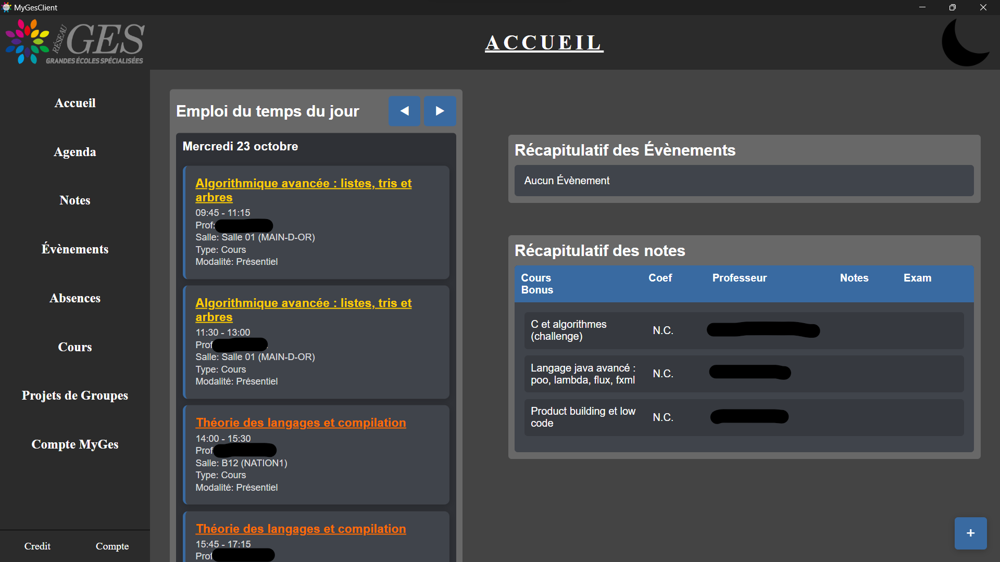
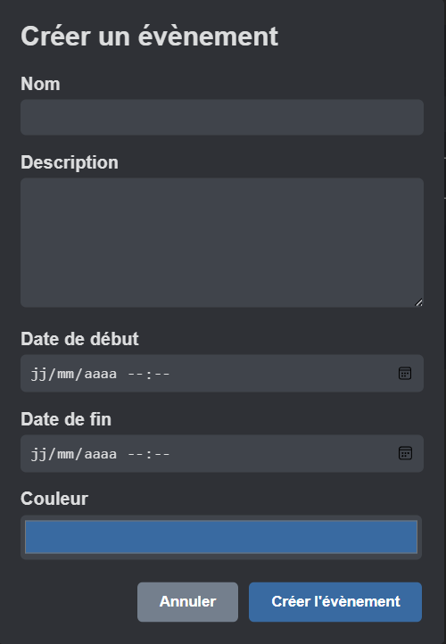

<details>
# This is an old message, the API live again ?? 
  
# 🛑MyGES API ETA summer 2025🛑
See [This issue](https://github.com/SebPautot/myges-documentation/issues/2)<br>
The API was shutdown T_T<br>
None of the issues will be fixed, including All ["In Progress"](https://github.com/users/Spatulox/projects/5/views/1) Issues

-------------------

</details>


# MyGes Client
[MyGes Client](https://github.com/Spatulox/MyGesClient) est un logiciel qui vous permet d'accéder facilement à vos informations MyGes, même hors ligne.

## ⚠️ Disclaimer ⚠️ 
Ce logiciel utilise l'API Scholae pour se connecter aux services MyGes (voir [MyGesApis](https://github.com/Spatulox/MyGesApis-OUTDATED)).<br>

## Fonctionnalités Principales
MyGesClient vous offre une vue d'ensemble de votre vie étudiante :
- Visualisation de l'agenda : Consultez vos emplois du temps passés, présents et futurs
- Suivi des notes : Accédez à vos résultats par semestre
- Gestion des absences : Gardez un œil sur vos présences et absences
- Informations du compte : Visualisez les données de votre profil MyGes

## Avantages clés
- Accès hors ligne : Grâce à SQLite, vos données sont stockées localement pour un accès rapide
- Mot de passe protégé : il est rangé dans le trousseau du système (Gestionnaire d'identification Windows, Trousseau macOS, gnome-keyring / KWallet sous Linux), pas dans la base locale. Sans trousseau disponible (certains environnements Linux), il reste dans la base locale comme avant
- Synchronisation régulière : Mise à jour fréquente avec MyGes pour des informations précises
- Support multi-comptes : Gérez plusieurs profils MyGes dans une seule application
  - 

<br>

## Fonctionnalités avancées
- Menu intuitif : Navigation simplifiée à travers l'application
- Tableau de bord récapitulatif : Vue d'ensemble de vos informations importantes
- Gestion d'événements locaux : Ajoutez vos propres rappels pour les contrôles, rendus, etc.
- Projets : Visualisez et gérez vos projets pédagogiques MyGes
    - Rejoignez ou quittez des groupes
    - Consultez les informations des projets
<br>

## Aperçu de l'interface
__Menu Principal__


__Évènements__<br>



Découvrez MyGesClient pour une gestion optimisée de votre parcours étudiant !

## Futur Ajouts
> [Voir l'avancement](https://github.com/users/Spatulox/projects/5/views/1)

<br><br><hr>
# Installation

Les binaires sont disponibles sur la [page des releases](https://github.com/Spatulox/MyGesClient/releases) :

| Système | Fichier | Architectures |
|---|---|---|
| Windows | `-windows-x64-setup.exe` (installeur, sans droits administrateur) ou `-windows-x64.zip` (portable : dézipper et lancer `MyGesClient.exe`) | x64 |
| Linux (Debian, Ubuntu…) | `.deb` (prendre celui de sa version d'Ubuntu, ex. `+ubuntu24.04`) | amd64, arm64 |
| macOS | `-macos-universal.zip` | Intel et Apple Silicon |

### macOS
L'application n'est pas signée par Apple : au premier lancement, macOS refuse de l'ouvrir.
Faites clic droit sur l'application > **Ouvrir**, ou lancez une fois :
```bash
xattr -dr com.apple.quarantine /Applications/MyGesClient.app
```

Rappels quand l'application est fermée (Compte > Rappels des évènements) : l'option installe un LaunchAgent
(`~/Library/LaunchAgents/io.github.spatulox.MyGesClient.service.plist`). macOS signale alors un « élément ajouté en arrière-plan ».
- Si vous le désactivez dans Réglages Système > Général > Ouverture, l'application ne peut pas le savoir : la case reste cochée. Décochez-la aussi dans MyGesClient.
- Les notifications passent par `osascript` : elles s'affichent au nom de « Éditeur de script ».

### Linux : dépannage
- **Mot de passe stocké sans chiffrement** : l'application range le mot de passe dans le trousseau du système (Secret Service).
  Sans trousseau (bureau minimal, WSL…), elle le garde dans sa base locale et le signale.
  Installez `gnome-keyring`, KWallet ou KeePassXC (avec l'intégration Secret Service) puis relancez l'application.
- **Fenêtre blanche** (pilote NVIDIA, machine virtuelle) : lancez avec `MYGES_GPU_POLICY=never MyGesClient`
  (ou `ondemand`), ou avec `WEBKIT_DISABLE_DMABUF_RENDERER=1 MyGesClient`.

### Logs
L'application écrit ses logs dans le dossier `MyGes/logs` du dossier de cache de l'utilisateur :
- Windows : `%LocalAppData%\MyGes\logs`
- Linux : `~/.cache/MyGes/logs`
- macOS : `~/Library/Caches/MyGes/logs`

On y trouve `MyGesClient.log` pour l'application, et `MyGesClient-service.log` pour le service de rappels en arrière-plan.

<br><br><hr>
# How to run the code

This code use the official [Wails](https://wails.io/) Vanilla template.

## Live Development

To run in live development mode, run `./wailsdev.sh` (or `wails dev`) in the project directory. This will run a Vite development
server that will provide very fast hot reload of your frontend changes. If you want to develop in a browser
and have access to your Go methods, there is also a dev server that runs on http://localhost:34115. Connect
to this in your browser, and you can call your Go code from devtools.

## Building

To build a redistributable, production mode package, use `./wailsbuild.sh` (or `wails build`).

Both scripts (environment in `wails-env.sh`) add Go's `bin` folder and nvm to the `PATH` and, on Linux, build with
WebKitGTK 4.1 (`-tags webkit2_41`) when it is installed.

Requirements: Go 1.26 or later, and the Wails CLI of the same version as `go.mod`
(`go install github.com/wailsapp/wails/v2/cmd/wails@v2.17.1`): `wails dev` rewrites `go.mod` when they differ.
